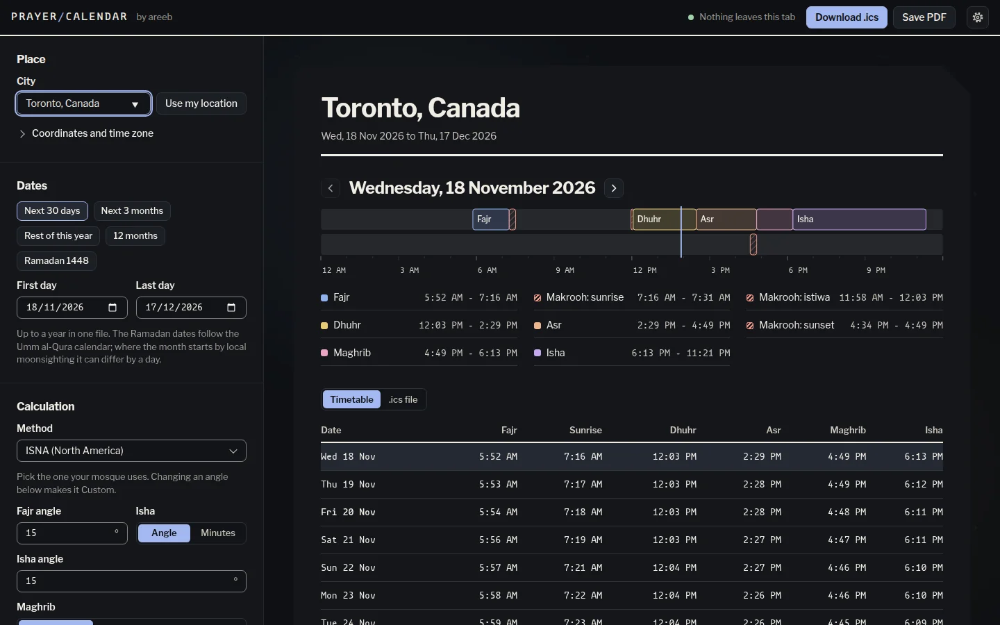

# Prayer Calendar

Prayer times for any location as a calendar file (.ics) or a printable timetable (PDF).

**Live:** [areeb-ece.github.io/PrayerCalendar](https://areeb-ece.github.io/PrayerCalendar/)

## Table of Contents

- [About](#about)
- [Screenshots](#screenshots)
- [Features](#features)
- [Technologies](#technologies)
- [Setup](#setup)
- [Usage](#usage)
- [Project Status](#project-status)
- [Credits](#credits)
- [Author](#author)
- [License](#license)

## About

Prayer Calendar works out Islamic prayer times for a place you choose and exports them as an `.ics` file for Google, Apple or Outlook Calendar, or as a printable PDF timetable. I made it to see my prayer windows on my calendar, find when I can catch each obligatory prayer, and plan ahead on busy days when a window is narrow. It is a static page with no build step, no framework and no server: everything is worked out in your browser tab.

## Screenshots



## Features

- Each prayer as an event lasting its whole window
  - Optionally the makrooh times and the gap between Fajr and Dhuhr
- **Place:** pick from a built-in list of 135 cities, use your browser's location, or paste coordinates from a map. The time zone comes with the city (or your device), and can be changed. Optional elevation.
- **Dates:** any range up to a year, with quick picks for the next 30 days, 3 months, the rest of the year, 12 months and the next Ramadan (from the Umm al-Qura calendar).
- **Method:** ISNA, Muslim World League, Egyptian, Karachi, Umm al-Qura, Dubai, Qatar, Kuwait, Gulf, Singapore, Diyanet, UOIF, Russia, Tehran and Shia Ithna Ashari, or your own Fajr and Isha angles (or Isha a set number of minutes after Maghrib, with a separate Ramadan value). Maghrib at sunset, minutes after it, or at an angle.
- **Asr:** Mithl (Shafi'i, Maliki, Hanbali), Mithlain (Hanafi), or **both at once**: two events, Asr (Mithl) and Asr (Mithlain), overlapping or split where the second begins, with Dhuhr ending at either.
- **Makrooh times:** sunrise (minutes after sunrise), istiwa (minutes before zawal, or from Dahwa Kubra, halfway between Fajr and sunset) and sunset (minutes before sunset).
- **The gaps:** an event for the time between Fajr and Dhuhr, which starts after the sunrise makrooh time and stops at istiwa when those are in the file, and one for the last third of the night.
- **Where windows end:** Asr at sunset or where the sunset makrooh time begins; Isha at midnight, the last third of the night or Fajr; the night measured from sunset to Fajr or to sunrise.
- **High latitudes:** where the sky never gets dark enough for the Fajr or Isha angle, the twilight angle rule, one-seventh of the night or the middle of the night places them, or they're left out. Days that use a rule are marked.
- **Adjustments:** minutes after zawal for Dhuhr, and ± minutes for each time to match a mosque's timetable.
- **The file:** switch each event on or off, rename it, add a reminder; Dhuhr can be called Jumu'ah on Fridays; prayer events can last the whole window or a set number of minutes; nearest or cautious rounding; free or busy; the place name and the day's times in each event's notes if you want them.
- Day-by-day preview before you download.
- **The timetable as a PDF:** the same days and times, black on white for printing, on Letter or A4, a page per month or months running on. Each page carries the place and how the times were worked out; Fridays are shaded and high-latitude days marked. Add a Hijri date column (with the Hijri months in each month's heading) and any of Ishraq, Istiwa, Zawal, the sunset makrooh time, midnight and the last third of the night.
- Settings are saved in your browser. The look (theme, accent, corners, motion, night sky) comes from the gear menu shared with [areeb-ece.github.io](https://areeb-ece.github.io/) and its other tools.

### Privacy

- The page's Content Security Policy includes `connect-src 'none'`: it can't send anything over the network. The city list is part of the page.
- "Use my location" asks your browser, which asks you first. The coordinates stay in the tab, and in this browser's saved settings until you reset them.
- No analytics, no trackers, no fonts or scripts from anywhere else.

## Technologies

- JavaScript (ES modules), HTML, CSS
- No runtime dependencies, no lockfile, no build step
- Dev/test only: Playwright 1.56.1 (installed with `--no-save`, Chromium) for the browser check; Node's built-in test runner (`node --test`) for unit tests
- Node 22 (version used in CI, `.github/workflows/test.yml`); Python 3 for the local static server

### How it's put together

**How the times are worked out.** The sun's declination and the equation of time come from the standard low-precision solar formulas, evaluated for each local date at the place and refined three times at each time's own moment. Fajr and Isha are when the sun is the chosen angle below the horizon; sunrise and sunset at 0.833° (refraction and the sun's radius, plus a dip for elevation); zawal when the sun crosses the meridian; Asr when a shadow is one (Mithl) or two (Mithlain) times an object's length plus its noon shadow. Every time is a UTC instant, and the file stores UTC, so daylight saving needs no special handling.

The unit tests check the times against [adhan-js](https://github.com/batoulapps/adhan-js), a separate implementation, at five places across both hemispheres: every time agrees to within a minute.

**Project layout.**

```text
index.html                 the page
css/style.css              its layout (colours and components come from /design/)
js/core.js                 the sun, the prayer times, the windows, the timetable's columns and the .ics file (no DOM)
js/pdf.js                  the timetable as a PDF: a small PDF writer and the page layout (no DOM)
js/cities.js               the city list
js/app.js                  the page's controls, timeline and timetable
js/theme.js                offline fallback for the shared design
assets/design/             copy of the portfolio's tokens.css and ui.css, for offline use
assets/fonts/              mononoki (Regular, Bold) and its OFL licence text
assets/icon.svg            icon
tests/                     core.test.js and pdf.test.js (node --test), browser-check.js (Playwright)
.github/workflows/test.yml CI
```

## Setup

### Prerequisites

- Node 22 (used in CI) for the tests
- Python 3, only for `npm run serve`
- Chromium via Playwright, only for the browser check

### Run it locally

There is no build step.

```bash
npm run serve                 # http://localhost:8080 (the shared design needs the portfolio; see below)
```

Or use the live page: [areeb-ece.github.io/PrayerCalendar](https://areeb-ece.github.io/PrayerCalendar/).

The shared design is served from `/design/` on the portfolio; `assets/design/` and `js/theme.js` are the offline fallback.

### Tests

```bash
npm test                      # unit tests (node --test)
npm i --no-save playwright@1.56.1 && npx playwright install chromium
npm run test:browser          # end-to-end check, offline fallback
DESIGN_DIR=../areeb-ece.github.io/public/design npm run test:browser   # with the shared design
```

## Usage

No input file is needed. Open the page, then:

1. Pick a city from the list (name, country, latitude, longitude and time zone are built in), or enter coordinates and a time zone.
2. Set the date range and the calculation settings (method, Asr, makrooh times, gaps, adjustments).
3. Check the day-by-day preview.
4. Download the `.ics` calendar file or the PDF timetable.

Check the times against your local mosque: methods and practice differ between communities, and this tool can't know which one yours follows.

## Project Status

**Complete**, and still updated when something should be added or changed. No new
features are planned for now.

## Credits

- The PDF uses the reader's built-in Helvetica, so no font is embedded; its widths are Helvetica's published metrics.
- [mononoki](https://github.com/madmalik/mononoki) by Matthias Tellen, SIL Open Font License (`assets/fonts/OFL-mononoki.txt`)
- The calculation methods' angles are as their organisations publish them, in the form [adhan-js](https://github.com/batoulapps/adhan-js) and [PrayTimes.org](http://praytimes.org/) document them.

## Author

Made by areeb ([areeb-ece.github.io](https://areeb-ece.github.io), [GitHub](https://github.com/areeb-ece)).

## License

MIT. See [LICENSE](LICENSE).
